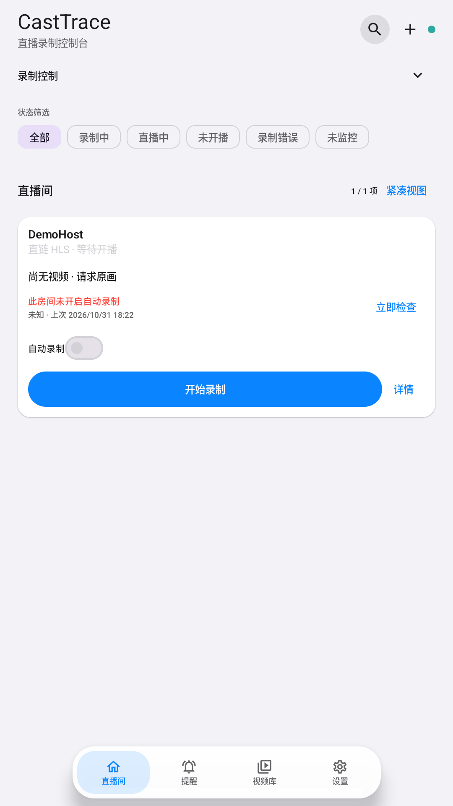
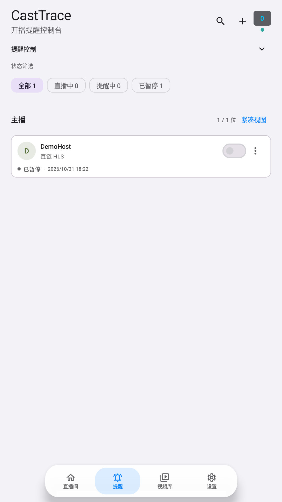
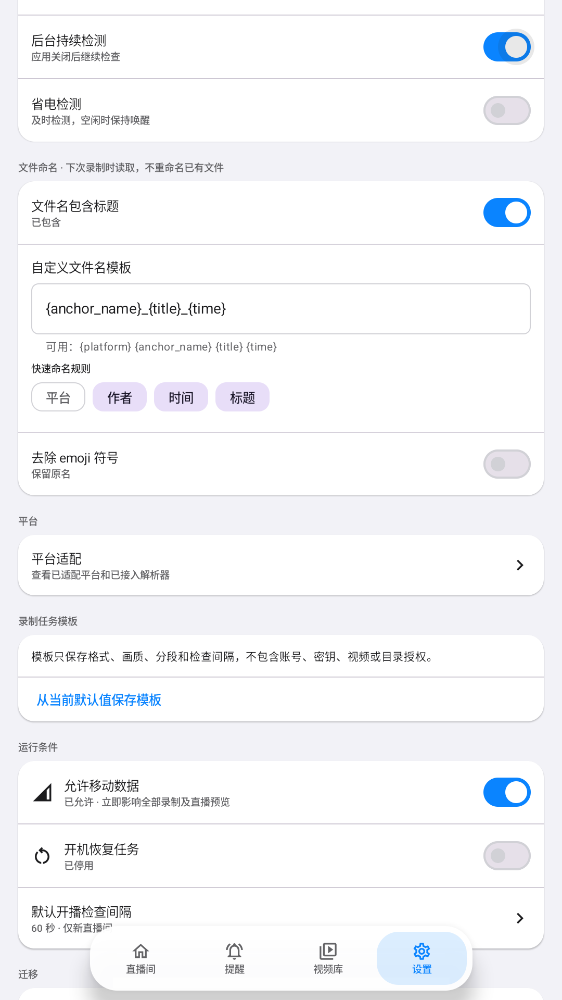

<h1 align="center">CastTrace Android</h1>

<p align="center"><a href="README.md">简体中文</a> | English</p>

<p align="center">
  <strong>Android live-stream monitoring and recording</strong><br>
  Manage rooms locally, monitor streams in the background, and resume interrupted recordings.
</p>

<p align="center">
  <a href="https://github.com/SRiftX/casttrace-android/actions/workflows/android-checks.yml"></a>
  <a href="https://github.com/SRiftX/casttrace-android/releases"></a>
  
  <a href="LICENSE"></a>
</p>

<p align="center"><a href="https://github.com/SRiftX/casttrace-android/releases"><strong>Download the latest APK</strong></a> · <a href="CONTRIBUTING.md">Contribute</a> · <a href="ARCHITECTURE.md">Architecture</a> · <a href="https://github.com/SRiftX/casttrace-android/issues">Report an issue</a></p>

## Screenshots

<p align="center"><strong>Phone layout</strong></p>
<p align="center">
  <a href="screenshots/live-rooms.png"></a>
  <a href="screenshots/live-reminders.png"></a>
  <a href="screenshots/settings.png"></a>
</p>
<p align="center"><sub>Room monitoring · Live reminders · Recording settings. Click an image to view it full size.</sub></p>

CastTrace is built with Kotlin, Jetpack Compose, Room, WorkManager, Media3 and FFmpegKit. It also supports live reminders, chat capture and local playback.

This is an independently maintained Android project that takes inspiration from the platform recording approach in [StreamCap](https://github.com/ihmily/StreamCap). It is not an official StreamCap mobile client. A platform being supported upstream does not mean that CastTrace supports it.

## Download

Download the APK and checksums from [GitHub Releases](https://github.com/SRiftX/casttrace-android/releases). CastTrace supports Android 8.0+ on `arm64-v8a` and `x86_64`. The APK uses the established CastTrace signing identity and can update an existing installation while retaining app data. Each release also includes CastTrace source, FFmpeg corresponding-source materials, the compatible AAR and SHA-256 checksums. See [RELEASING.md](RELEASING.md) for the release procedure.

## Features

- Manage multiple rooms and import room links, shared text or batches.
- Monitor live status in the background and schedule live reminders.
- Recover from short disconnects, expired stream URLs and process restarts.
- Save FLV, HLS/TS or MP4 recordings, including long-session segments.
- Browse, seek, rename, delete, export and share saved videos.
- Capture text chat on supported platforms and export videos with chat overlays.
- Back up room lists and app settings.

Background monitoring depends on notification permission, battery policy and vendor-specific startup controls. Some devices require CastTrace to be allowed to start and run in the background.

## Platform Support

The platform catalog tracks supported, needs-review, planned and stopped entries. Current supported entry points include Huya, Douyin, Bilibili, Douyu and direct HLS/FLV URLs. Some other platforms require device, account or regional verification. Recognizing a shared link does not guarantee that a room is live or recordable. See [`PlatformCatalog.kt`](app/src/main/java/com/streamcap/mobile/platform/PlatformCatalog.kt) for the current status.

## Build from Source

Requirements:

- JDK 17
- Android SDK Platform 35 and Build Tools 35.0.0
- Android 8.0 (API 26) or newer; APKs include `arm64-v8a` and `x86_64`
- The pinned FFmpegKit 7.1.6 AAR, verified by SHA-256

The AAR is excluded from Git. Download and verify it before building:

Linux and macOS:

```bash
mkdir -p app/libs
curl --fail --silent --show-error --location --proto '=https' --proto-redir '=https' \
  'https://repo.maven.apache.org/maven2/dev/ffmpegkit-maintained/ffmpeg-kit-https/7.1.6/ffmpeg-kit-https-7.1.6.aar' \
  -o app/libs/ffmpeg-kit-https-7.1.6.aar
echo 'e80e5ee52248a3dcb1dda0524dd784fe4bbb212dcd4d575e82e15d21a002d860  app/libs/ffmpeg-kit-https-7.1.6.aar' | sha256sum --check
```

Windows PowerShell:

```powershell
New-Item -ItemType Directory -Path app\libs -Force | Out-Null
Invoke-WebRequest `
  'https://repo.maven.apache.org/maven2/dev/ffmpegkit-maintained/ffmpeg-kit-https/7.1.6/ffmpeg-kit-https-7.1.6.aar' `
  -OutFile app\libs\ffmpeg-kit-https-7.1.6.aar
$expected = 'e80e5ee52248a3dcb1dda0524dd784fe4bbb212dcd4d575e82e15d21a002d860'
$actual = (Get-FileHash app\libs\ffmpeg-kit-https-7.1.6.aar -Algorithm SHA256).Hash.ToLowerInvariant()
if ($actual -ne $expected) { throw "Unexpected FFmpegKit AAR SHA-256: $actual" }
```

Set `ANDROID_HOME` to the local SDK. If Gradle reports `Unable to establish loopback connection` on Windows, use a short writable temporary path:

```powershell
$env:ANDROID_HOME = "$env:LOCALAPPDATA\Android\Sdk"
$env:TEMP = 'C:\tmp'
$env:TMP = 'C:\tmp'
New-Item -ItemType Directory -Path $env:TEMP -Force | Out-Null
./gradlew.bat --no-daemon :app:testDebugUnitTest :app:lintDebug :app:assembleDebug
```

Linux and macOS:

```bash
bash gradlew --no-daemon :app:testDebugUnitTest :app:lintDebug :app:assembleDebug
```

The Debug APK is written to `app/build/outputs/apk/debug/app-debug.apk`. The application ID remains `com.streamcap.mobile` for compatibility with existing installations and data.

## Developer Guide

Start with [CONTRIBUTING.md](CONTRIBUTING.md). Read [ARCHITECTURE.md](ARCHITECTURE.md) before changing dependency injection, recording lifecycle or data boundaries. See [RELEASING.md](RELEASING.md) for versioning and APK publishing.

Production code is under `app/src/main/java/com/streamcap/mobile/`:

- `app/`: Hilt root graph and Android entry points.
- `data/`: Room, preferences, network policy and repositories.
- `platform/`: platform identities, aliases and resolver construction.
- `service/`: background monitoring, recording coordination, recovery and publication.
- `storage/`: recording files, MediaStore, export, deletion and segment discovery.
- `ui/`: Compose screens and Hilt ViewModels.

To add a platform, update `PlatformCatalog` and add JVM tests for URL recognition, aliases and resolver selection. Preserve recording Intent actions and Room schema compatibility; database changes require a migration.

## Tests

Run the checks relevant to the change. Cross-module changes should pass:

```bash
bash gradlew --no-daemon :app:testDebugUnitTest :app:lintDebug :app:assembleDebug :app:assembleRelease
```

Instrumentation tests require a connected device or emulator. Real recording tests require an explicit authorized room ID and may create media files. Do not test rooms without permission to record them. Device test setup is documented in [CONTRIBUTING.md](CONTRIBUTING.md).

## License

Application source is licensed under [Apache License 2.0](LICENSE); see [NOTICE](NOTICE) for attribution. Third-party components retain their own licenses. FFmpegKit is an LGPLv3 build and its redistribution status is tracked separately from the application license. See [THIRD_PARTY.md](THIRD_PARTY.md) and [FFMPEG-LICENSE.md](FFMPEG-LICENSE.md).

## Contributing

Report reproducible issues through [GitHub Issues](https://github.com/SRiftX/casttrace-android/issues) and read [CONTRIBUTING.md](CONTRIBUTING.md) before opening a pull request. Remove cookies, account details, device identifiers and private recordings from reports.
