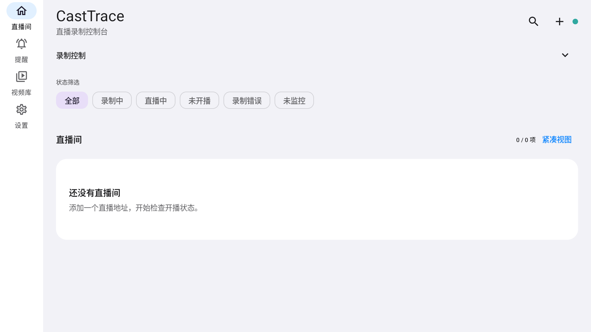

<h1 align="center">CastTrace Android</h1>

<p align="center">简体中文 | <a href="README.en.md">English</a></p>

<p align="center">
  <strong>Android 多平台直播监控与录制</strong><br>
  本机管理直播间，后台监控开播，自动录制并恢复中断任务。
</p>

<p align="center">
  <a href="https://github.com/SRiftX/casttrace-android/actions/workflows/android-checks.yml"></a>
  <a href="https://github.com/SRiftX/casttrace-android/releases"></a>
  
  
  <a href="LICENSE"></a>
</p>

<p align="center"><a href="https://github.com/SRiftX/casttrace-android/releases"><strong>下载最新版 APK</strong></a> · <a href="CONTRIBUTING.md">参与开发</a> · <a href="ARCHITECTURE.md">架构说明</a></p>

## 界面截图

<p align="center">
  <a href="screenshots/live-rooms-large-screen.png"></a>
  <a href="screenshots/live-reminders.png"></a>
  <a href="screenshots/settings.png"></a>
</p>
<p align="center"><sub>直播间监控台 · 开播提醒 · 录制与后台设置。点击图片可查看原尺寸。</sub></p>

<p align="center">
  <a href="#下载-apk">下载 APK</a> ·
  <a href="#功能">功能</a> ·
  <a href="#从源码构建">从源码构建</a> ·
  <a href="#开发入口">开发入口</a> ·
  <a href="#参与和反馈">参与和反馈</a>
</p>

CastTrace 使用 Kotlin、Jetpack Compose、Room、WorkManager、Media3 和 FFmpegKit 构建，支持直播提醒、弹幕采集与本地播放。

本项目参考了 [StreamCap](https://github.com/ihmily/StreamCap) 的平台录制思路，是独立维护的 Android 项目，并非 StreamCap 官方移动端；上游平台支持范围不代表本项目全部支持。

## 下载 APK

前往 [GitHub Releases](https://github.com/SRiftX/casttrace-android/releases) 下载 APK 和校验文件。应用支持 Android 8.0+，目前提供 `arm64-v8a` 与 `x86_64`。APK 使用 CastTrace 正式签名，可通过系统安装器覆盖旧版并保留应用数据。Release 同时提供应用源码、FFmpeg 对应源码材料、兼容 AAR 和 SHA-256 清单。发布门槛和步骤见 [RELEASING.md](RELEASING.md)。

## 功能

- 管理多个直播间，支持添加地址、分享文本和批量导入。
- 后台监控开播并自动开始录制，支持按时段设置直播提醒。
- 处理短暂断流、过期线路刷新和进程重启后的录制恢复。
- 保存 FLV、HLS/TS 或 MP4，支持长录制分段及未完成文件恢复。
- 浏览和播放本地视频，支持定位、重命名、删除、导出和分享。
- 采集已支持平台的文字弹幕，并导出带弹幕的视频。
- 备份直播间和应用配置，便于迁移。

后台能力受 Android 通知权限、电池策略及手机厂商的自启动管理影响。部分手机需要允许 CastTrace 自启动和后台活动。

## 平台状态

平台目录区分可用、需复核、计划支持和已停止的平台。目前标记为可用的主要入口是虎牙、抖音、B站、斗鱼及 HLS/FLV 直链。其他平台可能需要设备、账号或地区验证；识别出分享链接不代表房间正在直播或一定可录制。状态以源码中的 [PlatformCatalog.kt](app/src/main/java/com/streamcap/mobile/platform/PlatformCatalog.kt) 为准。

## 从源码构建

### 环境要求

- JDK 17
- Android SDK Platform 35 和 Build Tools 35.0.0
- Android 8.0（API 26）及以上；APK 仅包含 `arm64-v8a` 和 `x86_64`
- 开发构建使用 FFmpegKit 7.1.6 Maven AAR，SHA-256 必须与下方固定值一致。正式 Release 从锁定源码构建 FFmpegKit，并通过 `CASTTRACE_FFMPEG_AAR_PATH` 提供给 Gradle；两种 AAR 不声明逐字节相同。

克隆仓库并下载固定版本 AAR。AAR 不提交到 Git，Gradle 和 CI 会校验它的 SHA-256。

```bash
git clone https://github.com/SRiftX/casttrace-android.git
cd casttrace-android
mkdir -p app/libs
curl --fail --silent --show-error --location --proto '=https' --proto-redir '=https' \
  'https://repo.maven.apache.org/maven2/dev/ffmpegkit-maintained/ffmpeg-kit-https/7.1.6/ffmpeg-kit-https-7.1.6.aar' \
  -o app/libs/ffmpeg-kit-https-7.1.6.aar
echo 'e80e5ee52248a3dcb1dda0524dd784fe4bbb212dcd4d575e82e15d21a002d860  app/libs/ffmpeg-kit-https-7.1.6.aar' | sha256sum --check
```

Windows PowerShell:

```powershell
git clone https://github.com/SRiftX/casttrace-android.git
Set-Location casttrace-android
New-Item -ItemType Directory -Path app\libs -Force | Out-Null
Invoke-WebRequest `
  'https://repo.maven.apache.org/maven2/dev/ffmpegkit-maintained/ffmpeg-kit-https/7.1.6/ffmpeg-kit-https-7.1.6.aar' `
  -OutFile app\libs\ffmpeg-kit-https-7.1.6.aar
$expected = 'e80e5ee52248a3dcb1dda0524dd784fe4bbb212dcd4d575e82e15d21a002d860'
$actual = (Get-FileHash app\libs\ffmpeg-kit-https-7.1.6.aar -Algorithm SHA256).Hash.ToLowerInvariant()
if ($actual -ne $expected) { throw "Unexpected FFmpegKit AAR SHA-256: $actual" }
```

设置 `ANDROID_HOME` 指向本机 Android SDK。Windows 上若 Gradle 报 `Unable to establish loopback connection`，请使用短且可写的临时目录后再构建：

```powershell
$env:ANDROID_HOME = "$env:LOCALAPPDATA\Android\Sdk"
$env:TEMP = 'C:\tmp'
$env:TMP = 'C:\tmp'
New-Item -ItemType Directory -Path $env:TEMP -Force | Out-Null
```

运行单元测试、lint 并构建 Debug APK：

```bash
bash gradlew --no-daemon :app:testDebugUnitTest :app:lintDebug :app:assembleDebug
```

```powershell
./gradlew.bat --no-daemon :app:testDebugUnitTest :app:lintDebug :app:assembleDebug
```

APK 输出路径为 `app/build/outputs/apk/debug/app-debug.apk`。应用 id 保留为 `com.streamcap.mobile`，用于兼容已有安装和应用数据。

## 开发入口

新贡献者先读 [CONTRIBUTING.md](CONTRIBUTING.md)，修改依赖注入、录制生命周期或数据边界前先读 [ARCHITECTURE.md](ARCHITECTURE.md)。

生产代码位于 `app/src/main/java/com/streamcap/mobile/`：

- `app/`：Hilt 根组件及 Android 应用入口。
- `data/`：Room、偏好设置、网络策略和仓储组件。
- `platform/`：平台身份、别名和 Resolver 构造。
- `service/`：后台监控、录制协调、恢复和发布。
- `storage/`：录制文件、MediaStore、导出、删除和分段发现。
- `ui/`：Compose 页面和 Hilt ViewModel。

新增平台时更新 `PlatformCatalog`；只有通用 Resolver 不足时才增加专用实现，并为 URL、别名和 Resolver 选择补充 JVM 测试。保持录制 Intent action 与 Room schema 兼容；新增数据库结构时必须同时提供迁移。

## 测试

跨模块改动运行完整本地检查：

```bash
bash gradlew --no-daemon :app:testDebugUnitTest :app:lintDebug :app:assembleDebug :app:assembleRelease
```

Android instrumentation 测试需要已连接的设备或模拟器：

```bash
bash gradlew --no-daemon :app:assembleDebugAndroidTest
```

真实录制用例需要显式提供房间 ID，可能会创建媒体文件；只测试获得授权的直播间。设备验证的设置和发布检查见 [CONTRIBUTING.md](CONTRIBUTING.md) 与 [RELEASING.md](RELEASING.md)。

## 许可证

应用源码采用 [Apache License 2.0](LICENSE)，归属说明见 [NOTICE](NOTICE)。第三方组件仍采用各自许可证。FFmpegKit 是 LGPLv3 构建，其完整对应源码和二进制分发状态与应用许可证分别核验。发布前请查看 [THIRD_PARTY.md](THIRD_PARTY.md) 和 [FFMPEG-LICENSE.md](FFMPEG-LICENSE.md)。

## 参与和反馈

通过 [Issues](https://github.com/SRiftX/casttrace-android/issues) 报告可复现问题或提交功能建议。提交 PR 前请阅读 [CONTRIBUTING.md](CONTRIBUTING.md)。反馈前请移除 Cookie、账号信息、设备标识和私人录制内容。
